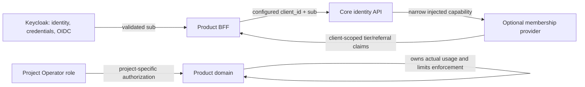

# Architecture and trust boundaries

[中文版本](architecture.zh-CN.md)

## Login path

```mermaid
sequenceDiagram
    actor User
    participant React as React portal / product
    participant BFF as Python BFF
    participant KC as Keycloak issuer
    User->>React: Open app
    React->>BFF: GET /api/me (same-origin cookie)
    BFF-->>React: 401 if no local session
    User->>React: Select sign in
    React->>BFF: GET /auth/login
    BFF->>BFF: Create state, nonce, PKCE verifier in server session
    BFF-->>User: Redirect to Keycloak
    User->>KC: Authenticate / register / verify email
    KC-->>User: Redirect with one-time code and state
    User->>BFF: GET /auth/callback
    BFF->>KC: Exchange code with PKCE verifier
    KC-->>BFF: Tokens and validated OIDC identity claims
    BFF->>BFF: Rotate session ID; store only server-side session data
    BFF-->>React: Redirect to same-origin app page
    React->>BFF: GET /api/me
    BFF-->>React: Issuer-scoped subject and verified email
```

Keycloak uniquely owns credentials, email verification, password recovery, issuer keys, authorization codes and SSO sessions. Every product registers its own confidential client, exact redirect URI and back-channel logout URL in the same realm. Products share an issuer-scoped `sub`; they do not share client roles or project membership implicitly. No OIDC token is written to browser storage or the local session database.

## Membership boundary



The client ID is fixed in each BFF's deployment configuration. Membership records, invitation attribution and rewards use `(client_id, sub)` scope. A product owns and enforces actual scan, diagnostic or other consumption; the optional module only supplies policy/plan claims. Core starts without importing membership and ordinary login remains available if the optional provider fails. The current starter does not include an Operator management API/UI or trusted Keycloak registration event adapter; each project supplies its authorization and an adapter must provide verified immutable signup facts before referral awards are enabled.

## Session lifecycle and controls

- Login uses Authorization Code with PKCE S256, state and nonce. Authlib validates the ID token against the issuer discovery metadata.
- Cookies are opaque, `HttpOnly`, `SameSite=Lax`, `Secure` outside loopback development. Login rotates the ID to prevent fixation.
- Session data is server-side SQLite with private filesystem permissions, an eight-hour idle expiry and a 30-day absolute expiry. Deployments with multiple BFF replicas must use a shared, transactional session store rather than a local per-container file.
- Logout requires an exact configured origin and session CSRF token, clears the local session, then uses the issuer's RP logout endpoint. The back-channel endpoint verifies signed RS256 Logout Tokens, issuer, audience, time claims, event purpose and `jti`; it revokes matching sessions idempotently.
- Keycloak local import enables verified-email registration, password reset, five-minute access tokens, refresh-token rotation and a local-only SMTP sink. Production must configure TLS, backup/recovery, secure secret distribution, monitored database durability, rate limiting, callback allowlists and provider key rotation.
- Offline users, email retries and OIDC authorization are not replaced by custom protocol logic. Membership is fail-closed for claims and isolated from core.
