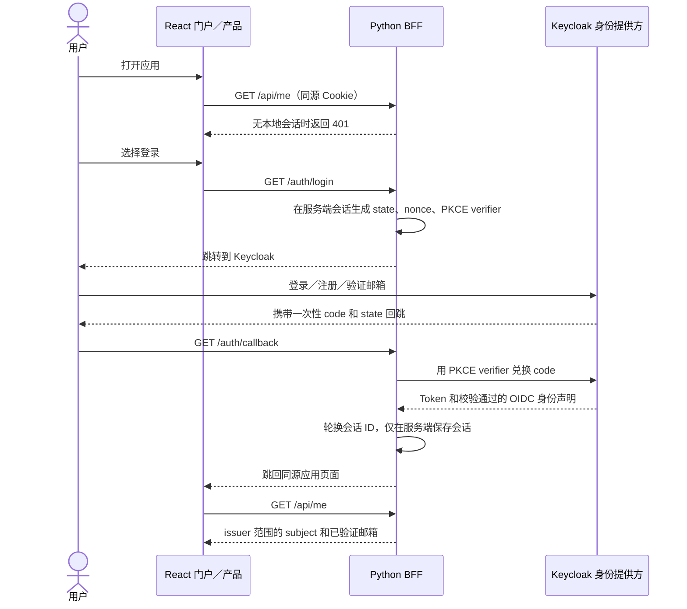
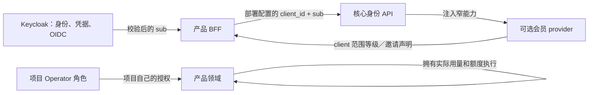

# 架构与信任边界

[English](architecture.md)

## 登录流程

Keycloak 唯一拥有凭据、邮箱验证、密码找回、issuer 密钥、授权码和 SSO 会话。每个产品都在同一 realm 注册独立 confidential client、精确回调地址和 back-channel logout URL。产品共享 issuer 范围的 `sub`，不会因此隐式共享 client 角色或项目会员。OIDC token 不写入浏览器存储或本地会话数据库。

## 会员边界

每个 BFF 的 client ID 固定在部署配置里。会员记录、邀请归属和奖励使用 `(client_id, sub)` 隔离。扫描、诊断等实际用量由产品记录和执行；可选模块只提供策略及方案声明。核心启动不导入会员模块；会员 provider 故障时普通登录仍可用，会员权限声明 fail closed。当前模板未包含 Operator 管理 API／界面或可信的 Keycloak 注册事件适配器；各项目需提供自身授权，邀请奖励启用前必须由适配器提供不可变且已验证的注册事实。

## 会话生命周期与控制

- 登录使用带 PKCE S256、state 和 nonce 的 Authorization Code 流。Authlib 根据 issuer discovery 元数据校验 ID token。
- Cookie 只含不透明随机 ID，带 `HttpOnly`、`SameSite=Lax`；除本地回环开发外必须 `Secure`。登录后轮换 ID，防止会话固定。
- 会话数据存于权限受限的服务端 SQLite，空闲 8 小时过期，绝对期限 30 天。多副本部署需要共享且支持事务的会话存储，不能使用容器本地文件。
- 退出要求精确来源和会话 CSRF token，清除本地会话后调用身份提供方的 RP logout。Back-channel 端点校验 RS256 签名、issuer、audience、时间声明、事件用途和 `jti`，并幂等撤销对应会话。
- Keycloak 本地导入启用验证邮箱注册、密码重置、5 分钟 access token、refresh token 轮换及本地邮件测试收件箱。生产必须配置 TLS、备份恢复、秘密分发、持久数据库、限流、回调白名单和密钥轮换。
- 本模板不自行实现 OIDC 协议。会员声明 fail closed，且与核心身份隔离。
